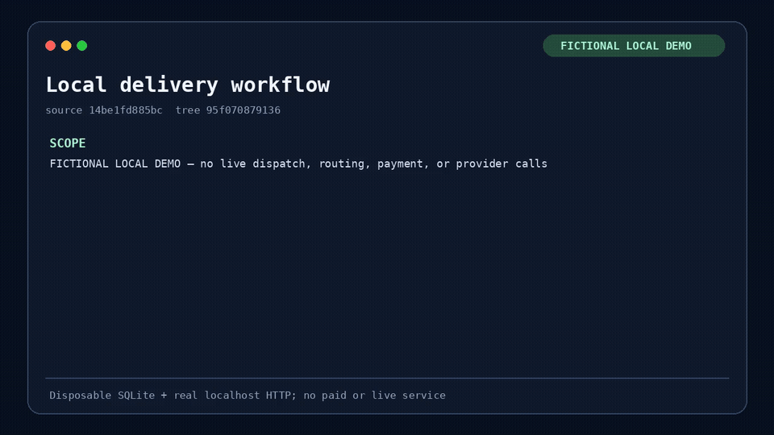

# Local delivery backend

A runnable food-delivery example backed by SQLite: quote a delivery, create an order, reserve the nearest available driver in the order's region, complete delivery, and retrieve the persisted result. Concurrent assignments cannot reserve the same driver twice; repeating an assignment returns the existing reservation.

## Run locally

Python 3.11 or 3.12:

```sh
python -m venv .venv
source .venv/bin/activate
pip install -r requirements.txt
python -m app.seed
python -m api.api_routes
```

The API binds to `127.0.0.1:5000`. Seeding requires an empty database and never clears existing data. Set `DATABASE_URL` before startup to choose another database.

```sh
curl -s http://127.0.0.1:5000/health
curl -s -X POST http://127.0.0.1:5000/orders -H 'Content-Type: application/json' -d '{"customer_id":1,"restaurant_id":1}'
curl -s -X POST http://127.0.0.1:5000/drivers/assign/1
curl -s -X PATCH http://127.0.0.1:5000/orders/1/status -H 'Content-Type: application/json' -d '{"status":"delivered"}'
curl -s http://127.0.0.1:5000/orders/1
```

`POST /pricing` accepts `customer_location` and `restaurant_location`, each a `[latitude, longitude]` list. Fees use geodesic distance. `POST /orders` validates existing customer and restaurant IDs. `POST /drivers/assign/<order_id>` returns 409 when capacity is exhausted and 404 for a missing order. The legacy GET assignment endpoint remains compatible; new clients should use POST.

## Reproducible demo and tests

```sh
python scripts/smoke_delivery.py
python -m pytest tests -q
```

The smoke demo uses a disposable SQLite database and real HTTP calls. It prices, creates, assigns, repeats the request, completes delivery, then restarts the server and reopens the database to verify persistence. Its fictional seed includes a geographically closer out-of-region driver and proves that regional capacity is not borrowed for the order. Assignment ranks drivers from the order's captured region and restaurant location, so later restaurant edits cannot redirect a pending delivery. Completing or cancelling an order releases its driver; terminal orders cannot be reassigned or reopened. It requires no external account or API key.



[MP4 demo](docs/demo/region-safe-delivery.mp4) · [source and media manifest](docs/demo/manifest.json)

The checked-in capture is rendered from the smoke command's actual output. Its
manifest pins the captured source commit, tree, every source blob, artifact
SHA-256 values, and Git blobs. `python scripts/verify_demo_media.py` checks those
pins, fully decodes both animations, validates their dimensions and duration,
and requires a clean checkout.

The demand module aggregates hourly order counts (including zero-order hours) and can fit a local Prophet model. JSON processing preserves every exported order and surfaces malformed inputs as failures.

## Optional integrations

The repository also contains examples for Google Directions, Airflow, RabbitMQ, Elasticsearch, and Jaeger. Those services require their own packages, credentials, and running infrastructure; they are outside the local delivery smoke workflow. Live routing requires `GOOGLE_MAPS_API_KEY` and has a ten-second request timeout. No payment processing, driver app, authenticated public deployment, or live integration is claimed by the local demo. The API is intended for local use; public deployment requires authentication and operational configuration.
